<a href="https://zyfr.com.br">
  
</a>

<p align="center">
  <a href="https://zyfr.com.br"></a>
  <a href="https://zyfr.com.br/servicos"></a>
  <a href="https://zyfr.com.br/solucoes"></a>
  
</p>

### Encontramos a falha antes do atacante. 🛡️

A **ZYFR** junta engenharia de software, perícia, segurança ofensiva e defensiva, IA, blockchain e geotecnologia numa engenharia só, para quem não pode errar.

- 🔴 **Ofensiva primeiro:** quem constrói aqui também sabe quebrar. Todo software, contrato e dispositivo que entregamos passa pelo nosso próprio ataque antes de ir ao ar.
- 🧪 **Prova, não promessa:** achado sem prova de conceito não entra no relatório. Cada falha vem com PoC, correção e plano de implantação.
- 🔎 **Dados públicos, método público:** OSINT, contabilidade forense e cadeia de custódia. Evidência organizada que sustenta laudo, denúncia e decisão.

---

## O que fazemos

<table>
  <tr>
    <td width="50%" valign="top">

**🔐 Segurança**
- [Segurança ofensiva](https://zyfr.com.br/servico/seguranca-ofensiva): pentest, red team, PoC por achado
- [Segurança defensiva](https://zyfr.com.br/servico/seguranca-defensiva): SOC, monitoramento e resposta 24/7

**💻 Software & IA**
- [Engenharia de software](https://zyfr.com.br/servico/engenharia-de-software)
- [Software para o setor público e organizações](https://zyfr.com.br/servico/software-setor-publico)
- [Inteligência artificial](https://zyfr.com.br/servico/inteligencia-artificial): modelos treinados com o seu contexto

**⛓️ Blockchain & criptoativos**
- [Blockchain e criptoativos](https://zyfr.com.br/servico/blockchain-e-criptoativos): tokens, contratos inteligentes, auditoria
- [Recuperação de carteiras de Bitcoin](https://zyfr.com.br/servico/recuperacao-de-carteiras-bitcoin)

</td>
    <td width="50%" valign="top">

**📡 Campo & infraestrutura**
- [IoT, automação e segurança de ativos](https://zyfr.com.br/servico/iot-automacao-seguranca-de-ativos)
- [Geotecnologia e drones](https://zyfr.com.br/servico/geotecnologia-e-drones): RGB, Lidar, base móvel
- [Infraestrutura e nuvem](https://zyfr.com.br/servico/infraestrutura-e-nuvem)

**⚖️ Jurídico & setor público**
- [Perícia forense](https://zyfr.com.br/servico/pericia-forense): coleta com cadeia de custódia
- [Consultoria e inteligência jurídica](https://zyfr.com.br/servico/consultoria-e-inteligencia-juridica)
- [Investigação de fraudes no setor público](https://zyfr.com.br/servico/investigacao-de-fraudes-setor-publico)
- [Auditoria em contas públicas](https://zyfr.com.br/servico/auditoria-em-contas-publicas)

**🎓 Educação**
- [Educação e treinamento](https://zyfr.com.br/servico/educacao-e-treinamento): trilhas práticas com laboratório

</td>
  </tr>
</table>

---

## Soluções

Antes de virar produto, cada solução da ZYFR foi ferramenta interna ou projeto de cliente. Construímos, testamos e atacamos cada uma antes de levar ao mercado.

| | Solução | O que faz |
|:-:|---|---|
| 🧩 | **[FY-CMS](https://zyfr.com.br/solucao/fy-cms)** | O CMS da casa: site público e painel num só sistema, temas num clique, IA embutida e analytics próprio (LGPD), sem um plugin sequer. `PHP 8.3` `CodeIgniter 4` `MySQL` |
| 📸 | **[FY-CAPTURE](https://zyfr.com.br/solucao/fy-capture)** | Prova de que a página existia daquele jeito naquele instante. Captura de página inteira com hash, carimbo de tempo e laudo pronto para juntar ao processo. |
| 💬 | **[FY-WA EXPORT](https://zyfr.com.br/solucao/fy-wa-export)** | Exporta conversas do WhatsApp Web com prova: HTML, PDF, TXT ou CSV, mídia em pastas, hash e carimbo de tempo, feito pelo próprio titular no aparelho. |

---

## Como entregamos

```
01 DIAGNÓSTICO  →  02 PROVA        →  03 CORREÇÃO          →  04 OPERAÇÃO
mapa de risco      PoC por achado     patch, roteiro e        monitoramento e
D+5                D+15               reteste · D+30          resposta · contínuo
```

<p>
  
  
  
  
</p>

---

## Stack

<p>

</p>

---

## Fale com a ZYFR

<p>
  <a href="https://zyfr.com.br/contato"></a>
  <a href="https://wa.me/5561998121360"></a>
  <a href="mailto:sac@zyfr.com.br"></a>
  <a href="https://www.linkedin.com/company/zyfr-ltda"></a>
  <a href="https://instagram.com/zyfr.ltda"></a>
  <a href="https://x.com/zyfrltda"></a>
  <a href="https://facebook.com/zyfr.ltda"></a>
</p>

> 🚨 **Incidente de segurança ou vulnerabilidade?** Escreva para **csirt@zyfr.com.br**.<br>
> 🔏 **Dados pessoais (LGPD):** **lgpd@zyfr.com.br**.

<sub>**ZYFR LTDA** · CNPJ 69.066.646/0001-78 · SGAS 915, nº 71, Conj. B, Bloco D, Sala 103, Asa Sul, Brasília/DF</sub>
